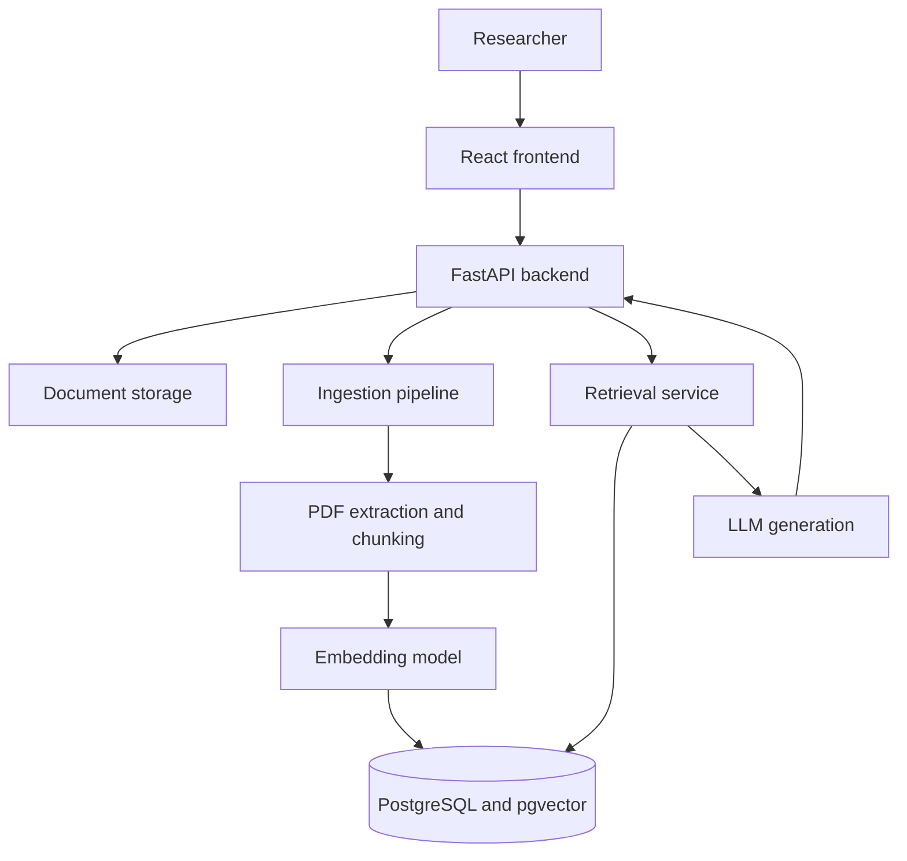

# Scientific Research Assistant

An open-ended, AI-powered research workspace for processing, searching, and synthesizing scientific literature across disciplines.

**Project status:** Planning — implementation has not started. The architecture, commands, and features below describe intended work, not a working release.

## 1. Problem and vision

Researchers and students spend considerable time reading, organizing, and comparing scientific papers. Keyword search alone can miss conceptually relevant passages, and AI-generated summaries can be difficult to verify.

The goal is to build an end-to-end application that lets users organize research collections, ingest documents, retrieve relevant evidence, and ask questions with traceable source citations. The system should support physics, computer science, biology, chemistry, medicine, and other scientific disciplines without requiring a separate model for each field.

### Target users

- Graduate students conducting literature reviews.
- Academic researchers comparing methods and findings.
- Scientists and R&D professionals exploring collections of publications.

### Product principles

- Evidence first: make supporting passages and page references accessible.
- Explicit uncertainty: abstain when the available evidence is insufficient.
- Reproducibility: document dependencies, configuration, and evaluation.
- Portability: support local installation with minimal setup.
- Privacy: use public, appropriately licensed papers for development; do not assume suitability for confidential or patient data.

## 2. Scope

### Minimum viable product (proposed)

- [ ] Create and manage research projects and document collections.
- [ ] Upload multiple text-based scientific PDFs.
- [ ] Extract text and preserve document identity and page numbers.
- [ ] Track ingestion status and report processing errors.
- [ ] Search using TF-IDF and cosine similarity as a baseline.
- [ ] Add semantic search using text embeddings.
- [ ] Ask questions across a selected collection using retrieval-augmented generation (RAG).
- [ ] Display answers with verifiable document and page citations.
- [ ] Open the original supporting passages and PDFs.
- [ ] Persist documents and metadata across application restarts.
- [ ] Provide a documented local installation using Docker Compose.

### Later enhancements

- [ ] Structured extraction of methods, sample sizes, results, and limitations.
- [ ] Side-by-side study comparison and identification of conflicting evidence.
- [ ] Hybrid retrieval and reranking.
- [ ] OCR for scanned documents; improved table, figure, and equation extraction.
- [ ] Literature discovery through permitted external APIs.
- [ ] Export findings and bibliographic references.
- [ ] Distributed ingestion with background workers and retry handling.
- [ ] Kubernetes deployment, scaling experiments, and observability.
- [ ] Authentication and authorization before any multi-user public deployment.

### Non-goals for the first release

Training a foundation model, replacing expert scientific judgment, processing confidential clinical records, exhaustive web literature discovery, or supporting every document format. Initial deployment is a single-user local research tool.

## 3. Example workflow

1. Create a project named `Thin-film solar cells`.
2. Upload a collection of research papers.
3. Monitor ingestion status until the papers are searchable.
4. Ask: “How does deposition temperature affect photovoltaic efficiency?”
5. Retrieve relevant passages and generate an evidence-grounded answer.
6. Open cited pages to verify the claims.
7. Save or export findings when those features become available.

## 4. Proposed architecture



Initially, ingestion and retrieval can be Python modules within one backend. Later, ingestion can be moved into background workers using Redis and Celery. Avoid introducing separate network services before there is a reason to do so.

### Ingestion pipeline

Validate upload → store original PDF → extract page-level text → chunk text → generate embeddings → persist chunks and metadata → update processing status.

### Question-answering pipeline

Validate query and collection → retrieve relevant chunks → assemble evidence → generate answer → validate citation identifiers → return answer and supporting passages. If evidence is inadequate, report that limitation rather than inventing a finding.

## 5. Proposed technology stack

| Layer | Technology | Purpose |
|---|---|---|
| Frontend | React, TypeScript, Vite | Interactive research workspace |
| Backend | Python, FastAPI | REST API and application logic |
| PDF extraction | PyMuPDF (license review required) | Page-level text extraction |
| Baseline retrieval | scikit-learn | TF-IDF and cosine similarity |
| Semantic retrieval | Sentence Transformers | Text embeddings |
| Database | PostgreSQL + pgvector | Metadata, chunks, vectors |
| File storage | Local persistent volume initially | Original PDFs |
| Generation | Local or hosted LLM, TBD | Evidence-grounded answers |
| Background jobs | Celery + Redis, later | Concurrent document processing |
| Containerization | Docker, Docker Compose | Reproducible local installation |
| Orchestration | Kubernetes (kind locally) | Deployment and scaling experiments |
| Testing | pytest, Vitest | Backend and frontend tests |
| CI/CD | GitHub Actions | Automated tests and image builds |
| Monitoring | Logs initially; Prometheus/Grafana later | Health and performance |

Dependencies and model choices are provisional. Review licenses before distribution, particularly PDF libraries and model weights. Prefer compatible alternatives if needed.

## 6. Proposed repository structure

```text
scientific-research-assistant/
├── README.md
├── .gitignore
├── .env.example
├── frontend/
│   ├── src/
│   ├── tests/
│   └── Dockerfile
├── backend/
│   ├── app/
│   │   ├── api/
│   │   ├── ingestion/
│   │   ├── retrieval/
│   │   ├── generation/
│   │   └── db/
│   ├── tests/
│   └── Dockerfile
├── evaluation/
├── docs/
├── deploy/
│   └── kubernetes/
├── compose.yaml
└── .github/workflows/
```

Create directories as needed; this is a target structure, not an existing codebase.

## 7. Development roadmap

| Milestone | Deliverable | Completion criterion | Status |
|---|---|---|---|
| 1. Product definition | User stories, acceptance criteria, scope | MVP and target users agreed | In progress |
| 2. Document processor | Python extraction module | Multiple PDFs parsed with correct page references; errors tested | Planned |
| 3. Backend API | FastAPI upload and status endpoints | Requests and responses tested locally | Planned |
| 4. Docker fundamentals | Backend Docker image | Build and run container; inspect logs and ports | Planned |
| 5. Retrieval | TF-IDF and semantic search | Relevant passages returned; baseline comparison recorded | Planned |
| 6. Persistence | PostgreSQL, pgvector, file storage | Data survives restart; migrations tested | Planned |
| 7. Frontend | React research workspace | Upload, status, search, and citation navigation work | Planned |
| 8. RAG | Grounded question answering | Answers cite evidence and abstain on unsupported questions | Planned |
| 9. Local release | Docker Compose and setup guide | Clean-machine installation verified | Planned |
| 10. Distributed ingestion | Redis and worker processes | Batch jobs, retries, and status updates tested | Planned |
| 11. Kubernetes | Local cluster deployment | Services communicate; worker scaling and recovery demonstrated | Planned |
| 12. Evaluation and distribution | Benchmarks, CI/CD, release artifacts | Results documented and release reproducible | Planned |

## 8. Evaluation and acceptance criteria

Create a small, manually labeled evaluation set of public scientific papers, questions, relevant passages, and unanswerable questions. Expand it across disciplines as the system matures.

| Area | Proposed measurement |
|---|---|
| Extraction | Correct page references; successful parsing rate |
| Retrieval | Recall@k, precision@k, MRR; compare TF-IDF and embeddings |
| Answer quality | Human-reviewed correctness and evidence support |
| Citations | Correct document/page and supporting passage |
| Abstention | Behavior on questions without supporting evidence |
| Performance | Ingestion throughput, query latency, resource usage |
| Scaling | Compare worker counts on the same workload and hardware |
| Reliability | Invalid uploads, duplicate documents, restart recovery |
| Usability | Successful completion of upload, search, and verification tasks |

Numerical performance targets will be chosen after baseline measurements. Do not claim accuracy or scalability before testing.

## 9. Installation and distribution (planned)

The preferred release will be a GitHub repository with versioned releases, Docker Compose configuration, pinned dependencies, sample configuration, and a small permitted demo dataset or instructions for obtaining one.

### Intended prerequisites

- Git (or a downloaded release archive).
- Docker with the Compose plugin.
- Sufficient memory and disk space for the selected embedding and generation models; requirements TBD after testing.
- Optional hosted LLM API credentials if the user chooses that provider.

### Intended quick start

The following commands are a proposed installation experience and will not work until the repository and configuration files exist.

```bash
# Clone the published repository (URL to be added).
git clone <repository-url>
cd scientific-research-assistant

# Create local configuration from the documented example.
cp .env.example .env

# Build and start the application services.
docker compose up --build
```

The final release will document the browser URL, health checks, configuration options, data persistence, backup, shutdown, troubleshooting, and supported operating systems. A local generation option is desirable to reduce dependence on paid APIs, subject to hardware and quality testing.

Kubernetes will be an optional deployment path, not a prerequisite for ordinary users. A native desktop installer is outside the initial scope; reconsider after the local web application is stable.

## 10. Engineering and learning standards

- Use concise, descriptive comments that explain non-obvious behavior and design decisions rather than restating code.
- Use descriptive names, modular functions, type hints where useful, and consistent formatting.
- Keep secrets out of Git; document environment variables in `.env.example`.
- Validate uploaded file types and sizes, handle malformed PDFs, and treat document text as untrusted input.
- Keep source provenance throughout extraction, retrieval, and generation.
- Add tests alongside features and use incremental Git commits.
- Maintain API contracts, architecture decisions, and setup instructions as the project evolves.
- Review third-party licenses and research-paper redistribution rights before publishing.
- Developer learning focus: Python, NLP, ML evaluation, REST APIs, SQL, Docker, Kubernetes, and CI/CD. AI assistance may lead React implementation; review and understand frontend/API integration.

## 11. Learning and mentorship plan

The project has two equally important goals: deliver a useful, distributable end-to-end scientific research assistant and develop the ability to understand, explain, debug, and extend its implementation independently. Progress is measured by both working software and demonstrated understanding, not by code volume or speed alone.

### Development responsibilities

| Area | Approach |
|---|---|
| Product definition and UX | Collaborative design and requirements decisions |
| React, TypeScript, and frontend styling | AI-assisted implementation with concise comments and walkthroughs; developer reviews, runs, and modifies the code |
| Python, APIs, databases, NLP, and RAG | Developer-led implementation with guided exercises, hints, code review, and debugging support |
| Docker, Kubernetes, CI/CD, and testing | Hands-on developer exercises with explanations and verification |
| Documentation and release | Collaborative; keep instructions accurate and distinguish proposed work from verified results |

### Session structure

1. Explain the problem and relevant theory, including why the technique is useful and its limitations.
2. Design a small component and define its expected inputs, outputs, and acceptance criteria.
3. Attempt the implementation independently in core learning areas; use hints before complete solutions where practical. Frontend implementations may be supplied directly.
4. Review code, explain unfamiliar syntax and dependencies, and debug failures together.
5. Test the component, including edge cases, and record observed results.
6. Complete a short knowledge check or explain the implementation in interview-style language.
7. Commit verified work and update the continuity log with the next concrete task.

Adjust the depth and pace as needed. There is no requirement to master an entire technology before using it. Revisit foundational concepts periodically and keep unresolved questions visible.

### Theory and practical exercises by milestone

| Milestone | Theory | Hands-on exercise |
|---|---|---|
| 1. Product definition | Functional vs. non-functional requirements; acceptance criteria; architectural tradeoffs | Define user stories and MVP boundaries |
| 2. Document processor | PDF structure, text extraction, Unicode, exceptions, time and space complexity | Extract page-aware text and test malformed or empty PDFs |
| 3. Backend API | HTTP, REST, JSON, multipart uploads, status codes, validation | Implement and test upload and status endpoints |
| 4. Docker | Images vs. containers, layers, processes, ports, volumes, networking | Write a Dockerfile, build an image, inspect logs, and verify persistence |
| 5. Retrieval | Tokenization, TF-IDF, cosine similarity, embeddings, ranking, retrieval metrics | Implement a baseline, compare semantic retrieval, and analyze failures |
| 6. Persistence | Relational schemas, keys, normalization, indexes, transactions, vector similarity | Design tables, write SQL, persist chunks, and inspect query behavior |
| 7. Frontend | Components, props, state, TypeScript types, asynchronous requests | Trace an upload from the UI to the API and modify a small component |
| 8. RAG | Context windows, retrieval vs. generation, grounding, hallucinations, prompt injection | Assemble evidence, validate citations, and test unsupported questions |
| 9. Local release | Compose networking, environment variables, persistent volumes, reproducibility | Start the stack from a clean checkout and verify documented setup |
| 10. Distributed ingestion | Queues, concurrency, retries, idempotency, failure handling | Run multiple workers and measure throughput and retry behavior |
| 11. Kubernetes | Pods, Deployments, Services, ConfigMaps, Secrets, probes, resource limits, scaling | Deploy locally, inspect resources, scale workers, and recover from a deleted pod |
| 12. Evaluation and distribution | CI/CD, regression testing, observability, benchmarking, release versioning | Run automated tests, document measurements, and verify installation on another machine |

### Definition of done (target release)

- [ ] Functional research interface and end-to-end ingestion.
- [ ] Persistent document storage, semantic search, RAG, and verifiable citations.
- [ ] Automated tests and documented retrieval and answer-quality evaluation.
- [ ] Reproducible Docker Compose installation and user/developer documentation.
- [ ] Optional Kubernetes deployment with measured scaling and recovery demonstration.
- [ ] CI/CD pipeline and versioned release artifacts.
- [ ] Successful installation on a separate machine or clean independent environment.
- [ ] Developer can explain the architecture, data flow, major design decisions, and known limitations, and independently troubleshoot core components.

### Learning and progress record

For each session, record: date, milestone, concepts covered, implementation completed, tests and results, remaining questions, relevant commit (if any), and next action. Keep unfinished exercises and unverified claims explicitly marked. Move detailed records to `docs/LEARNING_LOG.md` and `docs/PROGRESS.md` when useful.

## 12. Project continuity log

Update this section at the end of each development session, or move it into `docs/PROGRESS.md` as the project grows.

- **Current milestone:** 1 — Product definition.
- **Completed:** Broad scientific research focus selected; React/TypeScript frontend direction selected; end-to-end and containerization learning goals established; mentorship approach, theory curriculum, frontend responsibilities, and release completion checklist documented.
- **Next action:** Confirm MVP requirements, user stories, and acceptance criteria; then initialize the repository and implement a page-aware PDF extraction module.
- **Open decisions:** Project name, license, PDF library, LLM provider, model selection, initial dataset, performance targets, and release hardware requirements.
- **Known blockers:** No repository or implementation has been created yet. No dependencies, installation steps, or deployment configurations have been tested.

## 13. License and contributions

License: TBD. Do not assume the project is open-source until a license is selected and added. Before public distribution, review dependency and model licenses and add contribution instructions if external contributions are desired.
